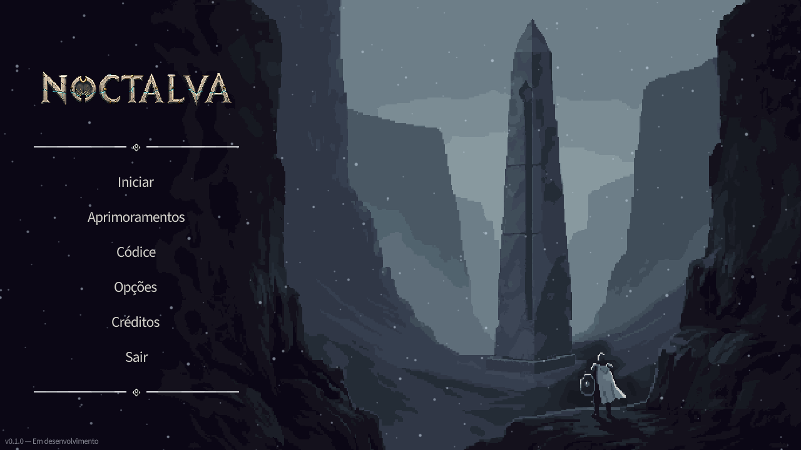
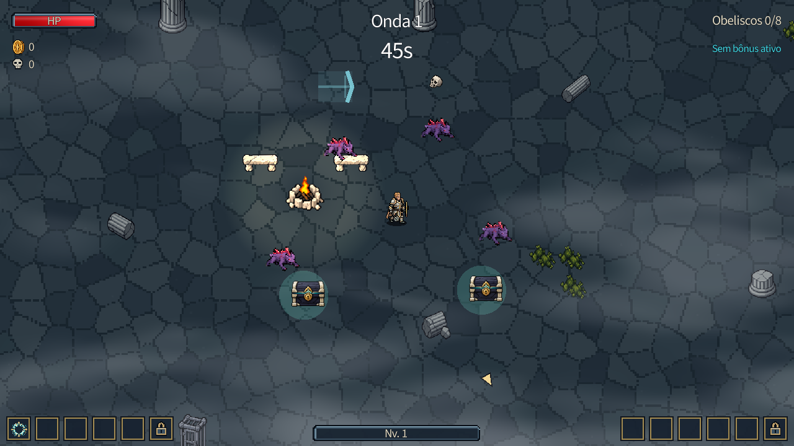
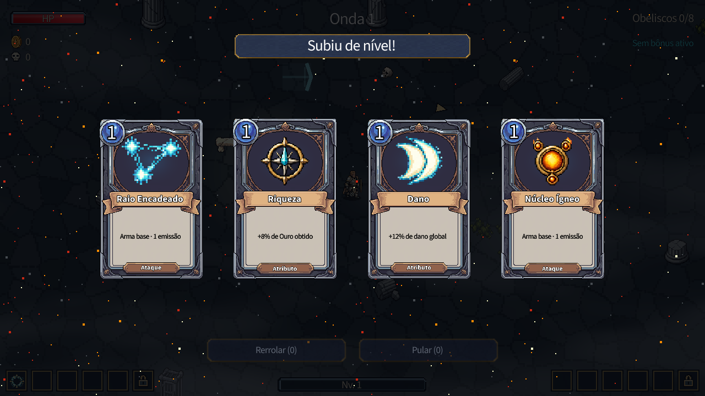

# Noctalva

**Um roguelite de sobrevivência em pixel art, em desenvolvimento.**

## Gameplay preview

https://github.com/user-attachments/assets/7fa5ae40-5fc8-4449-aad9-19c54df52dba

*Prévia de 16 segundos da versão em desenvolvimento, com movimentação, combate e escolha de melhorias.*

## O jogo

Enfrente hordas de monstros, sobreviva a ondas, combine ataques automáticos e escolha melhorias para construir sua build a cada expedição. Explore os cenários e desperte obeliscos ao longo da jornada.

Noctalva é um projeto autoral de [Pedro / zang9](https://github.com/zang9), criado com apoio de inteligência artificial.

## Menu e atmosfera

## Dentro da expedição

*Uma captura real da versão em desenvolvimento.*

## Escolhas e progressão

*Ataques e atributos moldam a build durante a expedição.*

## Ferramentas

- **Godot** — Game Engine.
- **PixelLab** — Criação e edição de pixel art.
- **Codex** — Programação e desenvolvimento.

## Acompanhe o projeto

Este espaço reúne a apresentação, o vídeo e imagens do Noctalva. O jogo está em desenvolvimento, e o visual e os sistemas podem mudar.

As capturas desta página foram registradas em outubro de 2026. O código-fonte permanece privado.

[Voltar ao perfil de zang9](https://github.com/zang9)
